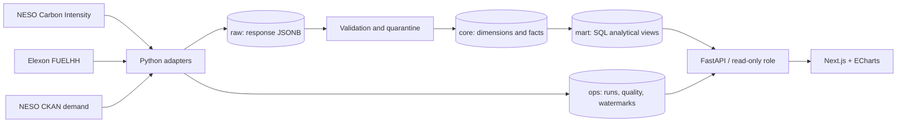

# Architecture

GridSignal is a monorepo with a Python ingestion worker, PostgreSQL 18 analytical store, FastAPI read service and Next.js workspace.

## Transaction and lineage boundaries

A run is registered before fetching. Source-specific PostgreSQL advisory locks prevent concurrent mutation of one source. Each original response is committed to `raw.api_response` with URL, HTTP status, retrieval time and content hash. A separate core transaction validates, quarantines invalid records, performs hash-sensitive upserts, records quality results and advances the watermark only on success. Failure preserves raw evidence and marks the run failed without committing partial core changes. Rejected records cause a partial run and no watermark advance.

Every fact references its source, ingestion run and original response. Carbon mutations append prior/new JSONB states to `core.carbon_revision`; other mutable facts append to `core.observation_revision`. Reader credentials cannot mutate facts or access raw responses. Database constraints supplement Pydantic checks.

## Grain preservation

Carbon is region × half hour, generation share is region × half hour × fuel × source, Elexon outturn preserves original fuel labels and published timestamps, and demand is settlement date × settlement period × source. National data uses region 0; region API aggregate GB ID 18 is excluded to avoid overwriting national estimated actuals. Regions 15–17 are country aggregates; comparisons use IDs 1–14 only.

SQL maintains grain before joins. For outturn, original fuel categories are first summed within each interval and mapped fuel before duration-weighted aggregation, so CCGT and OCGT contribute together to gas MW. Negative interconnector flows are valid and retained.

## SQL and application responsibilities

All KPI and analytical calculations execute in PostgreSQL. Python serialises query results and enforces query limits. Browser code formats numbers/timestamps, maps result rows into chart series and synchronises filters to the URL. Chart presentation is separate from analytical calculation. British calendar conversion in the browser only determines query boundaries.

Materialized views cache daily and distribution summaries. `mart.refresh_affected` is a narrowly scoped security-definer function with a fixed search path and revoked public execution; it refreshes only marts affected by changed source facts. Given the initial data volume, refreshes are transactional full refreshes of the relevant mart. Incremental partition replacement is a future optimisation, not claimed here.

## Operations

The worker polls carbon/regional/mix/Elexon every 30 minutes, demand/factors daily, and reconciles recent observations every six hours. Backfill supports one-day windows, failed-window retry and missing carbon-window detection. Each adapter enforces timeouts, conservative one-request-per-second pacing and bounded retry/backoff.

The dashboard defaults to a same-origin Next.js rewrite for local API access. In production use a verified public API origin or an explicit server-side internal API URL. No credentials are bundled into frontend code. Refresh reads persisted data and never triggers ingestion.

## Deployment boundary

Compose defines PostgreSQL, migration, API, worker and frontend services, optional pgAdmin, and a backup profile. Cloud deployment requires a persistent PostgreSQL service and worker-capable host. The frontend alone on Vercel is insufficient. Local native PostgreSQL 18 is available as an isolated fallback when Docker Desktop cannot initialise; this does not count as verification of Docker images.

