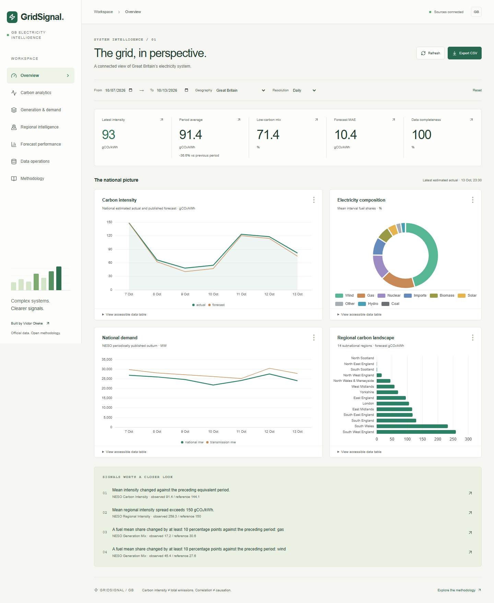
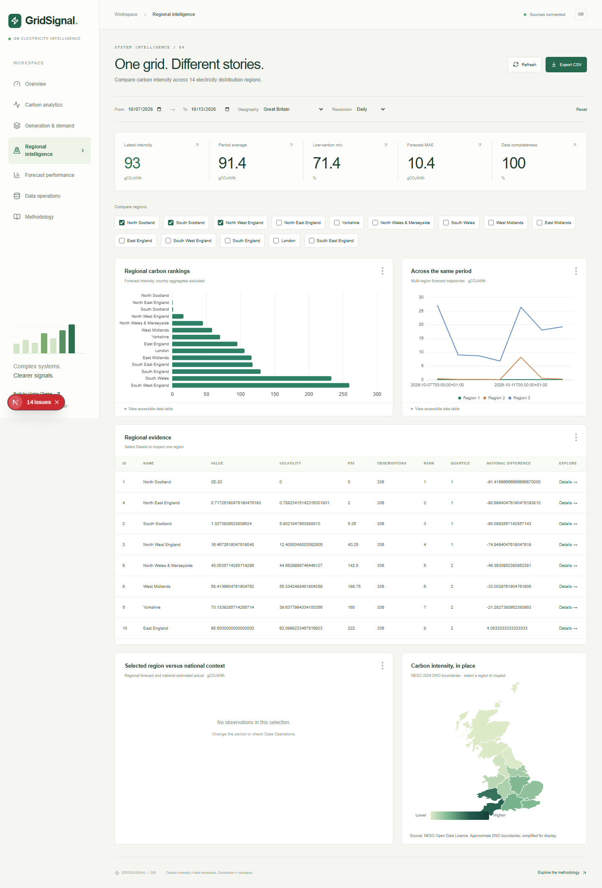
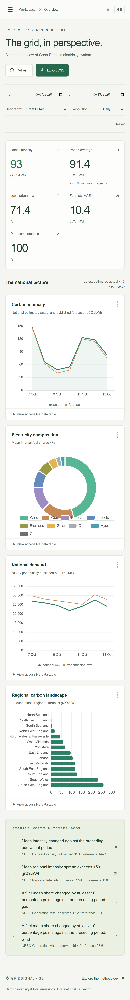

# GridSignal — electricity system intelligence

## The problem

Great Britain electricity data is distributed across providers with different observation grains, publication cadences and definitions. A chart that mixes forecast intensity, metered generation and demand without preserving these distinctions can support a confident but incorrect conclusion.

GridSignal creates a connected investigation workflow while retaining the source and meaning of each series.

## The system

Six ingestion adapters cover national carbon, regional estimates, generation mix, metered fuel outturn, demand and published carbon factors. Raw response JSONB, ingestion lineage, hash-sensitive facts and append-only revisions support traceability. PostgreSQL views calculate analytical outputs; FastAPI exposes bounded read-only queries; Next.js presents them in seven workspaces.

## Analytical questions

- When does carbon intensity vary most, and what does the selected observation coverage support?
- How do fuel composition and metered generation differ across reporting periods?
- Which electricity regions have higher published forecast intensity or variability?
- How large are published national forecast–estimate differences, and when do they occur?
- Is the evidence sufficiently fresh and complete to interpret?

## Important technical decisions

British settlement periods are mapped from local civil midnight to UTC, including 46- and 50-period days. Regional ID 18 returned by the API is excluded to preserve national actuals at internal ID 0. Demand F rows containing zero outturn fields cannot enter A-only analytics. CCGT/OCGT outturn is combined within an interval before time aggregation. Missing data is represented explicitly; null actuals are not replaced with forecasts.

The regional map uses NESO’s licensed 2024 DNO polygons, transformed from EPSG:27700 to EPSG:4326 with documented topology-preserving simplification. No regional geometry is fabricated.

## Interface

URL filters support reproducible views. Region comparisons, date drilldowns, CSV exports, accessible data tables and operational run inspection connect summary views to evidence. Source failures produce explicit unavailable states, not substituted values.

## Verification and findings

The actual verification snapshot is `verification.json`. It records row counts, endpoint responses, performance samples and an execution plan. At the initial 7–13 October 2026 national selection, the locally verified overview showed a mean intensity of approximately 91.4 gCO₂/kWh, mean low-carbon interval share of 71.4%, and a published forecast–estimate MAE of 10.4 gCO₂/kWh. These values describe that selection and data snapshot; they are not permanent product metrics or causal claims.

The first complete responsive browser suite passed 30 checks across desktop, tablet and mobile Chromium. Python tests include settlement calendars, source parsing, source failure handling, constraints, idempotence, revisions, paired error calculations and role separation. Further test totals and changes are recorded in the implementation status and final verification report.

## Deployment and limitations

The initial environment runs real PostgreSQL 18 natively because Docker Desktop fails during initialisation. Compose and CI build definitions are present, but container verification is explicitly tracked separately. A full public deployment requires authenticated persistent database/worker hosting; a frontend-only URL is not represented as a working deployed system.

Forecast issue-time vintages are not retrospectively reconstructed. Regional values are estimates. Metered outturn has incomplete embedded coverage. DNO boundaries are approximate and published at a different cadence from analytical observations.

## What the build taught me

Source contracts matter as much as model design: a documented region list omitted an additional GB aggregate, the wrong Elexon date parameter returned a current snapshot, and future demand rows contained zeros that were not outturn. Executing sample requests before modelling prevented those behaviours from becoming analytical assumptions.

Revision order is part of correctness. Elexon publication timestamps now determine which current outturn can replace another, and a database regression test prevents older publications overwriting newer facts. Raw responses and current-state deduplication solve different problems and are both retained.

The calendar is an analytical dataset. A continuous expected-interval calendar supports missing-data denominators and DST mapping, while source timestamps and successful-ingestion timestamps serve different freshness questions. Separating these concepts made operational status substantially more useful.

## Performance and validation

The local verification snapshot measured overview p95 at approximately 19 ms, carbon trend at 12 ms and regional ranking at 18 ms, from 20 sequential warm-pool HTTP requests per route. See the exact sampling scope and query plan in `verification.json`; these measurements are not hosted service guarantees.

The final local suite passed 34 Python/API/database tests and 30 production-browser checks across three device profiles. CI independently started the complete Compose topology and verified that every source ingested successfully and that the dashboard's same-origin API returned a persisted latest-intensity value.
