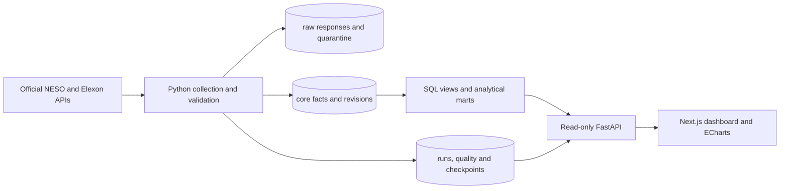

# GridSignal repository and code guide

Maintained by Victor Okeke. This guide describes the implementation reviewed on 14 October 2026.

## 1. The system in one view

GridSignal is a monorepo: one Git repository containing a Python data platform, a PostgreSQL warehouse, a FastAPI backend and a Next.js dashboard. These are separate runtime responsibilities, not four unrelated projects.

```text
gridsignal-gb/
├── apps/
│   ├── api/                 FastAPI, SQL services, response models and API tests
│   └── dashboard/           Next.js interface, charts, map and browser tests
├── pipelines/              Official-source acquisition, validation and ingestion
├── db/                     Schema SQL, analytical SQL, migrations and database tests
├── infrastructure/         Container images and deployment configuration
├── tools/                  Provisioning, verification and maintenance commands
├── docs/                   Architecture, methodology, contracts and evidence
├── .github/workflows/      CI and scheduled hosted collection
├── docker-compose.yml      Complete local service topology
├── render.yaml             Hosted API configuration
├── pyproject.toml          Python package and dependency declarations
└── uv.lock                 Locked Python dependency graph
```

The hosted services are Vercel (dashboard), Render Free (API), Neon PostgreSQL 18 (database), and GitHub Actions (six-hour collection jobs). Local development can instead run the complete Compose topology, including a continuous scheduler.



The browser does not connect directly to PostgreSQL. The public API has reader credentials. Collection uses writer credentials; schema migrations use a separate administrative connection.

## 2. Every tracked file

Paths below are relative to the repository root. Lock files, configuration, evidence and assets are included because they are part of the working project, even when they do not execute application logic.

### Root configuration

| File | Purpose |
|---|---|
| `.dockerignore` | Excludes local databases, credentials, dependencies and build output from the root Docker build context. |
| `.env.example` | Documents environment variables and local development connection settings. Copy it to an ignored environment file and replace development passwords before use. |
| `.gitattributes` | Controls repository file handling, including line-ending consistency. |
| `.gitignore` | Keeps credentials, runtime databases, dependencies, build output, logs and local tooling instructions out of version control. |
| `Makefile` | Provides shortcuts for setup, database startup, migration, ingestion, backfill, API/frontend startup, tests and local backups. |
| `README.md` | Introduces the project, its live links, architecture, official sources, development commands and documentation. |
| `alembic.ini` | Configures the Alembic migration directory and logging. Connection credentials are resolved by the migration environment rather than embedded here. |
| `docker-compose.yml` | Defines reproducible PostgreSQL 18, migration, API, worker and dashboard services. Optional profiles add pgAdmin and local backups. |
| `pyproject.toml` | Defines the Python package, runtime dependencies, development/deployment extras, the gridsignal CLI entry point and test/lint settings. |
| `render.yaml` | Declares the free Render API service, Dockerfile, readiness route and externally supplied reader/CORS environment values. It does not provision a paid worker or a Render database. |
| `uv.lock` | Pins the resolved Python dependency graph so development, CI and containers can install compatible versions reproducibly. |

### GitHub automation

| File | Purpose |
|---|---|
| `.github/workflows/ci.yml` | Runs Python/PostgreSQL verification, frontend checks/build, browser tests and full Docker Compose integration. Main pushes and pull requests trigger it. |
| `.github/workflows/ingestion.yml` | Runs hosted ingestion every six hours, at minute 23 UTC, or on manual dispatch. A repository variable enables it; the writer URL comes from an encrypted Actions secret. Concurrency protection prevents overlapping jobs, and the job timeout is ten minutes. |

### FastAPI backend

| File | Purpose |
|---|---|
| `apps/api/app/config.py` | Pydantic Settings loads environment variables and local .env values. It separates migration, writer and reader connections, CORS origins, source configuration and request limits. |
| `apps/api/app/db/session.py` | Creates the reusable SQLAlchemy reader connection pool, checks connections before reuse, applies a statement timeout and requests read-only transactions. |
| `apps/api/app/main.py` | Creates FastAPI, CORS, request logging/rate controls, liveness/readiness routes, registered analytics routes, region/run details, metric definitions and streamed CSV exports. Database failures become a controlled 503 response. |
| `apps/api/app/schemas/analytics.py` | Defines Filters, AnalyticsResult and Health models. Validates offset-aware dates, range bounds, region IDs, granularity, pagination and sort options before queries run. |
| `apps/api/app/services/analytics.py` | Holds the SQL query registry and dynamic query builders. Computes overview metrics and rule-based insights, executes parameterised statements and returns rows with source freshness and filter metadata. |
| `apps/api/tests/test_api.py` | Tests the API contract, health responses and invalid filter handling, including query bounds and validation failures. |

### Next.js frontend configuration and assets

| File | Purpose |
|---|---|
| `apps/dashboard/.dockerignore` | Excludes local frontend dependencies, environment files and build/test output from the dashboard Docker context. |
| `apps/dashboard/.gitignore` | Excludes Vercel's local project-link directory from the frontend checkout. The repository-root ignore rules also apply. |
| `apps/dashboard/Dockerfile` | Builds the dashboard in stages and runs the standalone Next.js output. Build arguments configure the API target for container deployments. |
| `apps/dashboard/eslint.config.mjs` | Applies Next.js/TypeScript lint rules and excludes generated frontend output from linting. |
| `apps/dashboard/next-env.d.ts` | Supplies Next.js TypeScript type references. It is framework infrastructure, not application behaviour. |
| `apps/dashboard/next.config.ts` | Enables standalone output, removes the powered-by header and defines the same-origin API rewrite used by local/Compose deployments. |
| `apps/dashboard/package-lock.json` | Pins the npm dependency tree used by npm ci. |
| `apps/dashboard/package.json` | Lists frontend dependencies and scripts for development, build, serving, linting, type checking and unit/browser tests. |
| `apps/dashboard/playwright.config.ts` | Defines browser-test settings and desktop, tablet and mobile projects. |
| `apps/dashboard/postcss.config.mjs` | Registers the Tailwind CSS PostCSS integration. |
| `apps/dashboard/tsconfig.json` | Configures TypeScript compilation, strictness, Next.js integration and the @/ source import alias. |
| `apps/dashboard/vercel.json` | Explicitly selects Vercel's Next.js framework adapter so builds produce the correct deployable routes. |
| `apps/dashboard/public/dno-regions.geojson` | Contains the simplified, reprojected distribution-region boundaries used by the map. The licence/source/transformation record is retained in the provenance documentation. |
| `apps/dashboard/public/favicon.svg` | Provides the browser-tab brand icon. |

### Frontend application code

| File | Purpose |
|---|---|
| `apps/dashboard/src/app/layout.tsx` | Defines the HTML/body shell, English language, global stylesheet import and page title/description metadata. |
| `apps/dashboard/src/app/page.tsx` | Renders Dashboard inside a Suspense boundary with the initial connecting state. |
| `apps/dashboard/src/app/globals.css` | Defines the visual system: colours, typography, sidebar, filters, metrics, panels, tables, dialogs, loading states, breakpoints, focus styles and reduced-motion behaviour. |
| `apps/dashboard/src/components/Dashboard.tsx` | Orchestrates the seven screens. Manages navigation, URL-backed filters, data queries, KPI strips, exports, comparison regions, drill-downs and the run-detail dialog. The hosted schedule environment variable changes collection text and background query refresh frequency. |
| `apps/dashboard/src/components/AnalyticsPanel.tsx` | Provides a reusable titled analytical panel, delayed connection messaging, errors/retry, empty states, charts and accessible data tables. Exports DataTable for reuse elsewhere. |
| `apps/dashboard/src/components/Chart.tsx` | Registers only the required ECharts modules, creates/disposes canvas charts, resizes them with ResizeObserver and forwards chart selections. Respects reduced-motion preferences and supplies chart ARIA labels. |
| `apps/dashboard/src/components/RegionalMap.tsx` | Loads the licensed GeoJSON, associates regional analytics with map features, renders the choropleth and forwards region selection. Offers a fallback if map rendering/data fails. |
| `apps/dashboard/src/lib/api.ts` | Centralises the API base URL, result/row types, cancellable requests, the 90-second hosted startup allowance, response checks, numeric formatting and Europe/London date helpers. |
| `apps/dashboard/src/lib/charts.ts` | Transforms analytical rows into ECharts configurations, including shared colours, axes, legends, tooltips and options for the supported chart kinds. |
| `apps/dashboard/tests/dashboard.spec.ts` | Exercises screen navigation, real API-backed rendering and interactions across the configured desktop/tablet/mobile browser projects. |
| `apps/dashboard/tests/formatting.test.mjs` | Tests British date labels, daylight-saving filter boundaries, missing-versus-zero formatting, hosted startup response handling and request cancellation. |

### Data acquisition, transformation and orchestration

| File | Purpose |
|---|---|
| `pipelines/__init__.py` | Marks the top-level pipelines directory as a Python package. |
| `pipelines/cli.py` | Implements the gridsignal commands: ingest, backfill, worker and quality. Supports source/date selection, missing/failed-window retries and the continuous local scheduler. refresh() reconciles one source using persisted progress. |
| `pipelines/clients/official.py` | Implements the HTTP client, pacing, bounded retries and source-specific acquisition. Fetches NESO carbon/regional/mix/factors, Elexon FUELHH publication windows and paginated NESO current/historical demand resources. |
| `pipelines/ingestion/runner.py` | Runs ingestion transactions: source locks, raw persistence, contract checks, normalisation, quarantine, batched hash-sensitive upserts, revision tracking, materialised-mart refresh and successful progress checkpoints. |
| `pipelines/orchestration/windows.py` | Calculates aligned extraction windows. Uses an overlap for reconciliation and bounded catch-up after missed runs; demand has a longer lookback than the half-hourly sources. |
| `pipelines/orchestration/hosted_refresh.py` | Runs each source once for GitHub Actions, checks the database-size guard, reports failures and closes the database engine. It exits instead of keeping a worker process alive. |
| `pipelines/transformations/calendar.py` | Converts British settlement dates/periods to UTC and generates half-hour calendar rows. Correctly handles the 46-, 48- and 50-period British days. |
| `pipelines/validation/contracts.py` | Checks response envelopes and required source fields. Records structural drift independently of individual-record validation. |
| `pipelines/validation/models.py` | Defines Pydantic models for carbon intervals, fuel shares, generation outturn and demand. Enforces types, bounds, offset-aware timestamps and interval rules while allowing legitimate signed interconnector flows. |
| `pipelines/validation/quality.py` | Evaluates persisted source freshness, calendar completeness and other integrity rules. Writes their outcomes to ops.quality_result for the dashboard. |
| `pipelines/tests/test_contracts.py` | Tests source contracts, validation and normalisation using checked source examples and deliberately invalid cases. |
| `pipelines/tests/test_reliability.py` | Tests acquisition retries and reliability/normalisation behaviour, including legitimate source edge cases. |
| `pipelines/tests/test_windows.py` | Tests half-hour alignment, reconciliation overlap and bounded recovery after an outage. |

### Database implementation

| File | Purpose |
|---|---|
| `db/migrations/env.py` | Connects Alembic using the migration credential and executes migrations in a transactional context. |
| `db/migrations/versions/0001_foundation.py` | Applies the initial schema and analytical SQL files. Its downgrade drops the four project schemas and is destructive. |
| `db/migrations/versions/0002_calendar.py` | Adds core.extend_calendar(), fills the continuous half-hour calendar and grants the writer permission to extend it during ingestion. |
| `db/sql/core/schema.sql` | Defines raw/core/ops/mart schemas; sources, runs, checkpoints and quality records; raw responses/quarantine; regions/fuels/calendar/facts; constraints/indexes; revision triggers; and role grants. |
| `db/sql/marts/views.sql` | Defines reusable analytical views, materialised summaries and refresh functions for carbon, fuel composition, outturn, demand, forecasts, source freshness and completeness. |
| `db/tests/conftest.py` | Provisions a separate temporary test database and credentials, applies migrations and cleans up that isolated test environment. |
| `db/tests/test_database.py` | Tests actual PostgreSQL behaviour: constraints, role isolation, idempotency, revisions, batch ordering, interrupted ingestion, locks, forecast errors, completeness and time/aggregation regressions. |

### Infrastructure

| File | Purpose |
|---|---|
| `infrastructure/docker/api.Dockerfile` | Builds the Python application with locked dependencies, copies API/pipelines/database files and runs Uvicorn under an unprivileged OS user. Compose reuses the image for migrations and the worker. |
| `infrastructure/docker/init-roles.sh` | Initialises separate writer and reader PostgreSQL login roles from supplied environment passwords when a fresh Compose database starts. |
| `infrastructure/deployment/README.md` | Explains deployment topology, credential separation, migration/backfill order, local backup/restore practice and release checks. Links to the selected free-tier setup. |
| `infrastructure/deployment/free-tier.md` | Documents the active Vercel/Render/Neon/Actions deployment, schedule, quota guards, account controls, verification evidence and operational limitations. |
| `infrastructure/deployment/railway.toml` | Retains an alternative Railway API build/start/readiness configuration. It is not the configuration used by the current hosted deployment. |

### Maintenance and deployment tools

| File | Purpose |
|---|---|
| `tools/configure_hosted_actions.py` | Uses existing GitHub authentication to encrypt and store the repository writer secret, enable hosted refresh and dispatch a run. Requires the deploy dependency extra and verified spending controls. |
| `tools/document_database.py` | Reads the actual PostgreSQL schema and analytical definitions to produce the data dictionary and metric catalogue. |
| `tools/github_status.py` | Reads CI/workflow progress through GitHub's API using the existing credential manager, without printing authentication tokens. |
| `tools/hosted_ingestion.py` | Loads a bounded initial reporting window into the hosted database using ignored local connection configuration. Redirects acquisition diagnostics to an ignored local log. |
| `tools/local_postgres.py` | Initialises/starts an isolated native PostgreSQL instance on loopback port 5440 when local Docker is unavailable, and prepares the project roles/database. |
| `tools/prepare_boundaries.py` | Acquires the official boundary source, transforms coordinates, simplifies geometry and writes the map asset and provenance record. |
| `tools/provision_neon.py` | Uses an authenticated Neon CLI profile to resolve the chosen database, create application roles, run migrations and verify reader isolation. Stores connection details only in ignored local configuration. |
| `tools/publish_repository.py` | Creates the private GitHub repository if needed and configures its origin remote using existing authentication. It does not embed credentials in source. |
| `tools/verify_hosted.py` | Checks anonymous frontend access, hosted API readiness, every analytical route, CORS, source successes and database counts/size. Its database transaction is explicitly read-only and it writes a dated evidence report. |
| `tools/verify_system.py` | Checks the local API routes, measured local request timings, real database counts and a query plan; writes the local verification snapshot. |

### Documentation and machine-readable evidence

| File | Purpose |
|---|---|
| `docs/architecture.md` | Describes service boundaries, transactions, source locks, revisions, query flow and recovery architecture. |
| `docs/boundary-provenance.json` | Records the official map source, licensing, coordinate transformation, simplification, region mapping and checksums. |
| `docs/case-study.md` | Presents the analytical problem, engineering approach, implementation and evidence as a portfolio case study. |
| `docs/data-dictionary.md` | Lists database objects, columns, types, relationships, constraints and indexes. |
| `docs/decisions/0001-postgresql-truth.md` | Records why PostgreSQL is the analytical source of truth and how the other services consume it. |
| `docs/hosted-verification.json` | Stores a dated snapshot of anonymous hosted checks, route results, row counts, database size and successfully ingested sources; it is evidence from that time, not a live feed. |
| `docs/implementation-status.md` | Tracks implemented/tested capabilities and operational work that remains outstanding. |
| `docs/methodology.md` | Explains metric interpretation, sources, aggregation, reporting time and analytical limitations. |
| `docs/metric-catalogue.md` | Catalogues the implemented analytical SQL, metrics and supporting definitions. |
| `docs/repository-guide.md` | This file: the repository inventory, implementation walkthrough and change-location guide. |
| `docs/source-contracts.md` | Documents authoritative acquisition endpoints, field contracts, source semantics and evidence samples. |
| `docs/verification-report.md` | Narrates local, CI, container, browser and hosted verification, with the scope and limitations of each check. |
| `docs/verification.json` | Stores the dated local API/database/performance evidence. It describes the local environment rather than current hosted metrics. |
| `docs/contracts/demand-historical.json` | Preserves a genuine historical-demand acquisition example for contract inspection. |
| `docs/contracts/dno-boundaries.json` | Preserves official boundary source metadata supporting the map provenance. |
| `docs/contracts/elexon.json` | Preserves a genuine Elexon FUELHH response example. |
| `docs/contracts/factors.json` | Preserves a genuine published carbon-factor response example. |
| `docs/contracts/generation.json` | Preserves a genuine national generation-share response example. |
| `docs/contracts/neso.json` | Preserves a genuine national carbon-intensity response example. |
| `docs/contracts/regional.json` | Preserves a genuine regional carbon-intensity/generation response example. |

### Screenshot evidence

| File | Purpose |
|---|---|
| `docs/screenshots/carbon-desktop.png` | Recorded desktop browser-verification image of the carbon screen. This is visual evidence, not a dashboard data source. |
| `docs/screenshots/carbon-mobile.png` | Recorded mobile browser-verification image of the carbon screen. This is visual evidence, not a dashboard data source. |
| `docs/screenshots/carbon-tablet.png` | Recorded tablet browser-verification image of the carbon screen. This is visual evidence, not a dashboard data source. |
| `docs/screenshots/forecasts-desktop.png` | Recorded desktop browser-verification image of the forecasts screen. This is visual evidence, not a dashboard data source. |
| `docs/screenshots/forecasts-mobile.png` | Recorded mobile browser-verification image of the forecasts screen. This is visual evidence, not a dashboard data source. |
| `docs/screenshots/forecasts-tablet.png` | Recorded tablet browser-verification image of the forecasts screen. This is visual evidence, not a dashboard data source. |
| `docs/screenshots/generation-desktop.png` | Recorded desktop browser-verification image of the generation screen. This is visual evidence, not a dashboard data source. |
| `docs/screenshots/generation-mobile.png` | Recorded mobile browser-verification image of the generation screen. This is visual evidence, not a dashboard data source. |
| `docs/screenshots/generation-tablet.png` | Recorded tablet browser-verification image of the generation screen. This is visual evidence, not a dashboard data source. |
| `docs/screenshots/methodology-desktop.png` | Recorded desktop browser-verification image of the methodology screen. This is visual evidence, not a dashboard data source. |
| `docs/screenshots/methodology-mobile.png` | Recorded mobile browser-verification image of the methodology screen. This is visual evidence, not a dashboard data source. |
| `docs/screenshots/methodology-tablet.png` | Recorded tablet browser-verification image of the methodology screen. This is visual evidence, not a dashboard data source. |
| `docs/screenshots/operations-desktop.png` | Recorded desktop browser-verification image of the operations screen. This is visual evidence, not a dashboard data source. |
| `docs/screenshots/operations-mobile.png` | Recorded mobile browser-verification image of the operations screen. This is visual evidence, not a dashboard data source. |
| `docs/screenshots/operations-tablet.png` | Recorded tablet browser-verification image of the operations screen. This is visual evidence, not a dashboard data source. |
| `docs/screenshots/overview-desktop.png` | Recorded desktop browser-verification image of the overview screen. This is visual evidence, not a dashboard data source. |
| `docs/screenshots/overview-mobile.png` | Recorded mobile browser-verification image of the overview screen. This is visual evidence, not a dashboard data source. |
| `docs/screenshots/overview-tablet.png` | Recorded tablet browser-verification image of the overview screen. This is visual evidence, not a dashboard data source. |
| `docs/screenshots/regional-desktop.png` | Recorded desktop browser-verification image of the regional screen. This is visual evidence, not a dashboard data source. |
| `docs/screenshots/regional-mobile.png` | Recorded mobile browser-verification image of the regional screen. This is visual evidence, not a dashboard data source. |
| `docs/screenshots/regional-tablet.png` | Recorded tablet browser-verification image of the regional screen. This is visual evidence, not a dashboard data source. |
| `docs/screenshots/hosted-mobile.png` | Mobile screenshot of the actual HTTPS deployment. |
| `docs/screenshots/hosted-overview.png` | Overview screenshot of the actual HTTPS deployment. |


## 3. Follow one observation through the code

### Step A: decide what to collect

`pipelines/cli.py` exposes the command through the package entry point declared in `pyproject.toml`:

```toml
[project.scripts]
gridsignal = "pipelines.cli:main"
```

Consequently, `gridsignal backfill --source carbon --start ... --end ...` calls `main()` in that file. The command parses the requested source/dates and splits the reporting window into bounded source requests. The continuous worker calls `refresh(source)`; the hosted one-shot job calls the same refresh function and then exits.

`refresh()` reads the source's saved checkpoint from `ops.ingestion_watermark`. `extraction_windows()` determines where acquisition should resume, with overlap to catch revisions. Here, **watermark means a data-collection progress checkpoint**. It is part of the ingestion design.

### Step B: acquire authoritative responses

`OfficialClient.requests()` chooses the source endpoint. Its shared `get()` method paces requests, applies timeouts, retries transport/HTTP failures and rejects source error envelopes. Demand acquisition also discovers the correct yearly resource and paginates it.

Publication time and observation time are different. Elexon requests use publication-window parameters; the returned observation retains its original half-hour time. That distinction matters when an older observation is revised later.

### Step C: preserve evidence and validate

`ingest()` first creates an operational run and obtains a source-specific PostgreSQL advisory lock. Only one process can mutate the same source at a time.

Each original HTTP response is committed to `raw.api_response` before the core processing transaction. If later processing fails, the acquired source response remains available for investigation.

Two validation layers then operate:

1. `contract_drift()` checks whether the response still has the expected envelope and fields.
2. Pydantic models validate individual observations: timestamps, interval lengths, field types and numeric bounds.

Rejected records and contract failures are retained in `raw.quarantine`. There is no replacement with invented observations.

### Step D: normalise and write facts

`normalise()` yields a target table, a normalised record and its unique-key columns. For example, a carbon observation is identified by its region and interval start. Fuel-share observations also include fuel and source in their key.

The runner attaches run/response identifiers and calculates a content hash excluding acquisition lineage fields. Fetching the same observation again therefore does not create a revision simply because the new fetch has a different run ID.

`upsert_batch()` groups writes into bounded batches. Repeated keys split a batch, preserving the original sequence of versions. `_write_batch()` performs PostgreSQL `INSERT ... ON CONFLICT DO UPDATE` only when the content hash differs. For Elexon outturn, an older publication cannot overwrite a newer stored publication.

The returned PostgreSQL rows distinguish inserted and updated facts; unchanged/skipped facts count as duplicates. Database triggers retain old/new values when meaningful changes occur.

### Step E: publish progress and quality

After accepted changes, the source's affected materialised marts are refreshed. A successful run advances its checkpoint. A rejected/empty window does not silently move the source past missing data. A failed core transaction rolls back its fact changes, preserves already committed raw evidence and records the failed run.

`check_quality()` writes freshness, completeness and integrity results. These are actual persisted operational records displayed by the Data Operations screen.

## 4. Understand the database layers

| Schema | Responsibility | Typical objects |
|---|---|---|
| `raw` | Original acquisition and rejected evidence | `api_response`, `quarantine` |
| `core` | Normalised facts and reference data | `region`, `fuel_type`, `reporting_calendar`, carbon/generation/demand facts, revisions |
| `mart` | Reusable analytical definitions and summaries | Forecast errors, carbon summaries, generation/demand analytics, freshness/completeness views |
| `ops` | Collection and quality observability | `data_source`, `ingestion_run`, `ingestion_watermark`, `quality_result` |

The reporting calendar provides expected intervals independently of received data. Without it, a missing interval could disappear from both numerator and denominator and make incomplete data look complete.

`0001_foundation.py` installs the schema and analytical definitions. `0002_calendar.py` adds a database function that extends the calendar as acquisition expands. Alembic records which versions have been applied, so deployments do not blindly recreate tables.

Metrics remain in SQL rather than being independently recalculated in each chart. For example:

```sql
WHERE period_start >= :start AND period_start < :end
```

This selects a start-inclusive, end-exclusive window. `:start` and `:end` are bound values, not raw user strings interpolated into SQL. Approved granularity/sort choices are validated before the dynamic SQL builder uses them.

Carbon intensity is measured in gCO₂/kWh; it is not total emissions. Fuel shares are percentages. Outturn is power in MW; interval duration is needed to derive MWh. Keeping those meanings distinct prevents attractive but misleading charts.

## 5. Follow a dashboard request

1. `Dashboard.tsx` reads navigation and filters from the URL and builds API parameters. Sharing a URL preserves the selected analytical view.
2. TanStack Query uses the route/filter combination as a cache key. Changing a filter requests the corresponding dataset; cancelling a stale request prevents it from superseding a newer selection.
3. `getData()` in `src/lib/api.ts` sends the request to the configured API. Hosted requests allow time for Render to resume after inactivity and reject unexpected HTML startup responses with a useful retry message.
4. FastAPI's `get_filters()` validates dates, region IDs, resolution, pagination and sort. Invalid requests receive a 422 response before analytics execute.
5. The registered endpoint calls `query(route, filters)` in `services/analytics.py`. It selects the appropriate SQL, executes it through the reader pool and adds filter/source metadata.
6. `AnalyticsPanel` renders loading, error, empty, chart or table states. `chartOption()` converts returned rows into chart options; `Chart` owns the ECharts instance and cleans it up on unmount.

Typical response structure:

```json
{
  "rows": [],
  "meta": {
    "start": "...",
    "end": "...",
    "region": 0,
    "sources": [],
    "count": 0
  }
}
```

This illustration describes the response shape; it is not project data.

The API route factory in `main.py` avoids repeating an identical handler for each analytical route:

```python
def endpoint(route):
    def handler(filters: Filters = Depends(get_filters)):
        return query(route, filters)
    return handler
```

The surrounding registration loop attaches the handler to `/api/v1/<route>`. Region performance, run details, metric definitions and CSV exports have dedicated handling.

CSV export streams the full filtered dataset from a consistent database snapshot, independently of the UI's table pagination. It also protects spreadsheet users against formula interpretation of untrusted cell strings.

## 6. How the interface is assembled

`Dashboard.tsx` is currently the largest UI file. It holds the seven screen compositions, shared filter/navigation state, overview metrics and the operational run dialog. The smaller components isolate reusable rendering responsibilities:

- `AnalyticsPanel`: panel chrome, query state, charts and accessible tables.
- `Chart`: chart-instance lifecycle, resizing and selection events.
- `RegionalMap`: GeoJSON-specific rendering and regional selection.
- `lib/charts.ts`: chart options and visual encodings.
- `lib/api.ts`: transport, response types, date and number formatting.
- `globals.css`: shared styling and responsive layouts.

The root page/layout remain small; the interactive workspace is a client component. The use of client-side charts does not mean all analytical computation runs in the browser: aggregation still happens in PostgreSQL.

The seven screens share the same facts and filters but answer different questions: overview, carbon patterns, generation/demand, regional comparisons, forecast differences, collection operations and methodology. The insights are explicit SQL/rule-based signals; there is no trained machine-learning model in the current application.

British time conversion is deliberate. Facts retain offset-aware timestamps, while settlement dates/hourly profiles use Europe/London. The date helpers and database calendar handle daylight-saving transitions instead of assuming every reporting day has exactly 48 half hours.

## 7. Deployment, security and operations

The public API receives only the reader connection. The scheduled collection job receives the writer connection through a repository secret. Migration/provisioning tools use an administrative connection locally; it is not passed to the browser.

`NEXT_PUBLIC_API_URL` is intentionally public: it is the API address, not a password. `NEXT_PUBLIC_DATA_REFRESH_HOURS` describes collection cadence in the interface. Database URLs and authentication credentials must never use the `NEXT_PUBLIC_` prefix.

GitHub Actions runs collection every six hours. Observations can still have half-hour resolution. Browser background query refresh is a third, separate concept: revisiting PostgreSQL results does not cause a new upstream collection run.

Render can sleep when idle. Neon and GitHub impose free-tier limits. The hosted refresh entry point checks database size before each source and stops at its conservative guard; it does not automatically delete evidence. The documented quota controls and ten-minute job timeout bound work but do not guarantee uninterrupted service under unlimited traffic.

`docs/*verification*.json` files are dated measurements. They should not be treated as configuration or as the current live database state. Independent hosted backup automation is not currently configured; see the operational guide for the exact scope of available recovery.

## 8. Where to make common changes

| Change | Primary files | Check before release |
|---|---|---|
| Headings, navigation or screen composition | `Dashboard.tsx` | Keyboard/mobile behaviour, URL state, lint/types |
| Colours, spacing and responsive layouts | `globals.css` | Contrast, mobile overflow, reduced motion |
| Chart appearance or a supported chart type | `lib/charts.ts`, `Chart.tsx` | Units, axis labels, accessible table, imported ECharts module |
| Add a chart using an existing endpoint | `Dashboard.tsx`, `AnalyticsPanel.tsx` | Correct filters, loading/empty states, descriptive title |
| Add a new analytical metric | `services/analytics.py`, possibly `db/sql/marts/views.sql`, metric documentation | SQL correctness, grain, null handling, DB regression test |
| Add a source | `official.py`, validation contracts/models, `runner.py`, source registry migration | Genuine contract sample, lineage, retries, idempotency, quality checks |
| Change database structure | New file in `db/migrations/versions/` | Migration on a fresh database and upgrade path; do not rewrite applied history |
| Adjust hosted collection cadence | `ingestion.yml`, Vercel schedule environment value, operational documentation | Free quota budget, job duration, source freshness |
| Change API host | Render configuration, Vercel API environment value, CORS origins | HTTPS, exact origins, anonymous access and startup behaviour |
| Change regional boundaries | `prepare_boundaries.py`, public GeoJSON and provenance record | Licence, coordinate system, region mapping and map alignment |

A useful later refactor would split the large Dashboard and SQL registry into screen/domain modules while retaining the existing interfaces. That is a maintainability improvement, not a feature already implemented.

## 9. Read and verify in this order

For the main code path, start with `pipelines/cli.py` → `clients/official.py` → `ingestion/runner.py` → the core/mart SQL → API `main.py` and `services/analytics.py` → frontend `lib/api.ts` → `Dashboard.tsx` → chart components.

Useful commands:

```sh
uv sync --extra dev
uv run ruff check .
uv run pytest -q
```

Set `RUN_DB_TESTS=1` in the shell to include the PostgreSQL integration tests, with the documented local database prerequisites available. The fixture creates a separate temporary test database; do not point destructive migration tests at production.

```sh
cd apps/dashboard
npm ci
npm run lint
npm run typecheck
npm run test:unit
npm run build
npm run test:e2e
```

Browser tests require the API/dashboard and real ingested observations to be running, as CI prepares them. CI also verifies the full Compose topology. Do not rebuild into the same Next.js output directory while a local standalone server is using it on Windows.

## 10. Local files outside the published repository

The local workspace can contain `.venv/`, `.local/`, `node_modules/`, `.next/`, `.vercel/`, environment files and framework-created development instructions. These are excluded from GitHub. In particular, `.local/` contains native PostgreSQL runtime/data, logs and provisioning connection configuration; it is not safe material to upload.

Third-party source licences, source attribution, dependency lockfiles and framework type references remain part of a professional reproducible project. They serve different purposes from personal project authorship.
